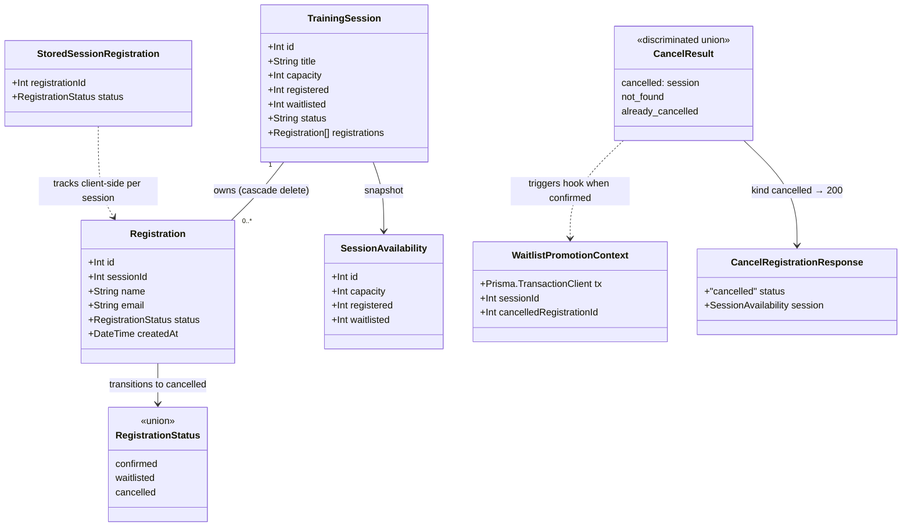

# Cancel Registration

## Requirements

1. Allow a registered employee to cancel their training-session registration using their registration ID, releasing their confirmed seat so it becomes available for another employee (and can trigger waitlist promotion in WH-5).
2. Preserve cancellation history by transitioning the registration's lifecycle status to `cancelled` in the database while atomically updating the session's capacity counter, preventing negative counts or double-decrements under concurrent requests.
3. Enforce clear cancellation outcomes over HTTP: return HTTP 200 `{ status: "cancelled" }` (with updated session availability) on success, HTTP 404 when the registration does not exist for that session, HTTP 409 when already cancelled, and HTTP 400 for malformed identifiers.
4. Provide a transactional post-cancellation hook seam invoked whenever a confirmed registration is cancelled, so automatic waitlist promotion (WH-5 / LATC-5) attaches cleanly inside the same database transaction without expanding this story's scope.
5. Expose an unambiguous self-service cancellation flow on the session card: show a "Cancel Registration" button for employees with a confirmed registration, prompt with `"Are you sure you want to cancel your registration for [Session Title]?"`, display `"Your registration has been cancelled"` on confirmation, update the displayed registered/spots-left count, and remove or disable the Cancel action once cancelled.
6. Boundaries: email confirmation (WH-8), organiser-initiated cancellation, user authentication, and full waitlist-promotion execution (WH-5) are out of scope. No Prisma schema changes are required.

## Entities

Notes:
- No database schema changes are needed: `Registration.status` (string defaulting to `"confirmed"`), `TrainingSession.registered`, `TrainingSession.waitlisted`, and indexes `[sessionId]` and `[sessionId, status]` already exist in `api/prisma/schema.prisma`.
- `RegistrationStatus` already includes `'cancelled'` in both `api/src/services/registrationService.ts` and `app/src/types/index.ts`.
- `CancelRegistrationResponse` is a strict superset of `{ status: "cancelled" }`, adding `session: SessionAvailability` so the frontend updates card counts authoritatively in one round-trip, matching `POST /registrations`.
- `StoredSessionRegistration` is a lightweight client-side record persisted per `sessionId` in `localStorage` so an employee's registration identity survives page refreshes without authentication.

## Approach

1. **Data Model & Transaction Boundary (reuse existing schema and serial queue)**:
   - Keep `api/prisma/schema.prisma` unchanged. Registrations are soft-cancelled (`status` transitions to `'cancelled'`), never deleted, so repeat cancellations reliably produce HTTP 409 and future audit stories preserve history.
   - Execute `cancelRegistration` through the same per-process `serialize` queue in `api/src/services/registrationService.ts` used by `registerForSession`, inside one `prisma.$transaction`. Sharing the serial queue prevents SQLite busy-wait starvation when bookings and cancellations run concurrently.
   - Inside the transaction, look up the registration scoped by both `id: registrationId` and `sessionId`. Scoping by `sessionId` prevents cross-session cancellation or decrementing the wrong session's counter.
   - Guard session counter decrements with a positive floor (`registered: { gt: 0 }` for confirmed rows; `waitlisted: { gt: 0 }` for waitlisted rows) via conditional `updateMany` so counters never drop below zero.

2. **Waitlist Promotion Seam (WH-5 boundary)**:
   - Accept an optional `{ onConfirmedCancelled?: WaitlistPromotionHook }` parameter on `cancelRegistration`, defaulting to an async no-op hook (`noopWaitlistPromotion`).
   - Invoke `await onConfirmedCancelled({ tx, sessionId, cancelledRegistrationId: existing.id })` inside the cancellation transaction **only** when a `'confirmed'` registration transitions to `'cancelled'`, immediately after decrementing `registered` and **before** reading the final `SessionAvailability` snapshot.
   - This guarantees atomicity (a hook error rolls back the cancellation) and ensures that when WH-5 plugs in a real promoter, the returned `session` snapshot automatically reflects post-promotion counts without changing `cancelRegistration`'s structure.
   - When cancelling a `'waitlisted'` registration, decrement `waitlisted` (not `registered`) and do not invoke `onConfirmedCancelled`, preserving counter invariants for both active statuses.

3. **HTTP Contract & Error Handling**:
   - Add `DELETE /:registrationId` to the existing sub-router `api/src/routes/registrations.ts` (already mounted at `/api/training-sessions/:id/registrations`).
   - Parse both `:id` and `:registrationId` as strict positive integers (`/^\d+$/` or `parseInt` with integer validation). Return `400 { error: 'Invalid session ID' }` or `400 { error: 'Invalid registration ID' }` before calling the service.
   - Map `CancelResult` via an exhaustive `switch (result.kind)` with a `never` guard:
     - `'cancelled'` → `200 { status: 'cancelled', session: result.session }`
     - `'not_found'` → `404 { error: 'Registration not found' }`
     - `'already_cancelled'` → `409 { error: 'Registration is already cancelled' }`
   - Catch unexpected errors locally in the route and return `500 { error: 'Failed to cancel registration' }` without exposing stack traces or internal details. Leave the deliberate global error handler in `api/src/app.ts` untouched.

4. **Frontend Interaction & Client-Side Registration Tracking**:
   - Store the employee's registration per session (`Record<number, StoredSessionRegistration>`) in `localStorage` under a dedicated key (e.g. `'workshophub.registrations'`) with safe JSON parsing and validation, hydrated into React state in `RegistrationForm` (or a small helper module under `app/src/lib/`).
   - When `POST /api/training-sessions/:id/registrations` succeeds with 201 (`confirmed`), record `{ registrationId: data.registration.id, status: 'confirmed' }` for that session.
   - When the session has a stored `'confirmed'` registration, display a `"Cancel Registration"` button on the session card.
   - Clicking `"Cancel Registration"` opens an inline confirmation prompt inside the card displaying `"Are you sure you want to cancel your registration for ${session.title}?"` with `"Yes, cancel registration"` and `"Keep registration"` buttons (avoiding native `window.confirm` dialogs).
   - Confirming sends `DELETE /api/training-sessions/${session.id}/registrations/${registrationId}`. On HTTP 200, call `onAvailabilityChange(data.session)`, mark the stored registration status as `'cancelled'`, hide the confirmation prompt, disable/replace the cancel control with a disabled `"Cancelled"` button (or hide the Cancel button — choose disabled `"Cancelled"` button so cancelled state is unmistakable while allowing a new registration via `"Register"`), and display `"Your registration has been cancelled"`.
   - On HTTP 409 (stale client state where registration was already cancelled elsewhere), transition local stored status to `'cancelled'` and show the server error message gracefully.

5. **Testing Strategy (TDD, slice by slice)**:
   - Backend unit tests (`api/tests/unit/registrationService.test.ts`): mocked Prisma client verifying confirmed cancellation, waitlisted cancellation, `not_found`, `already_cancelled`, shared serialisation with `registerForSession`, error propagation, and `onConfirmedCancelled` hook invocation/skipping/rollback semantics.
   - Backend integration tests (`api/tests/integration/registrations.test.ts`): Supertest against real SQLite with self-created fixtures and `afterEach` cleanup covering 200 (status + DB status + `registered` decrement + `waitlisted` decrement), 400 (invalid IDs), 404 (missing registration, missing session, registration belonging to another session), 409 (already cancelled), and concurrency (parallel `DELETE`s on the same registration yield one 200 and one 409 with a single decrement; parallel `DELETE` and `POST` preserve capacity and counter invariants).

## Structure

### Inheritance Relationships
1. No classes or inheritance are used. Backend and frontend follow the existing module-with-exported-functions and TypeScript discriminated-union style.
2. `CancelResult` is a discriminated union on `kind` (`'cancelled' | 'not_found' | 'already_cancelled'`), narrowed exhaustively in `api/src/routes/registrations.ts`.
3. `WaitlistPromotionHook` is a function type `(context: WaitlistPromotionContext) => Promise<void> | void` providing the WH-5 extension seam inside the cancellation transaction.
4. On the frontend, `CancelRegistrationResponse` and `ErrorResponse` in `app/src/types/index.ts` are narrowed from `unknown` using runtime type guards.

### Dependencies
1. `api/src/routes/registrations.ts` imports `cancelRegistration` (and `CancelResult`) alongside `registerForSession` and `validateRegistrationInput` from `api/src/services/registrationService.ts`.
2. `api/src/services/registrationService.ts` depends only on `api/src/lib/prisma.ts` (and `type Prisma` from `@prisma/client`) for `$transaction`, `registration.findFirst`, `registration.update`, `trainingSession.updateMany`, and `trainingSession.findUnique`.
3. `api/src/app.ts` already mounts `registrationsRouter` at `/api/training-sessions/:id/registrations` — no changes needed in `app.ts`.
4. `app/src/components/RegistrationForm.tsx` depends on `app/src/types/index.ts` and a small `app/src/lib/registrationStorage.ts` helper for `localStorage` read/write; it calls `DELETE /api/training-sessions/:id/registrations/:registrationId` and notifies `TrainingSessionCard` / `TrainingSessionsPage` via `onAvailabilityChange`.
5. `app/src/components/TrainingSessionCard.tsx` and `app/src/pages/TrainingSessionsPage.tsx` continue passing `session` and `onAvailabilityChange` without needing extra plumbing.

### Layered Architecture
1. **Route layer** (`api/src/routes/registrations.ts`): HTTP only — parse `:id` and `:registrationId`, call `cancelRegistration`, map `CancelResult` to 200/404/409 JSON responses, catch unexpected errors as 500 `{ error }`. No Prisma imports.
2. **Service layer** (`api/src/services/registrationService.ts`): business rules, serialised single-transaction cancellation, counter floor protection, and invocation of the `WaitlistPromotionHook` seam. All Prisma access lives here.
3. **Data layer** (`api/prisma/schema.prisma`, `api/src/lib/prisma.ts`): unchanged `TrainingSession` and `Registration` models via the single shared Prisma client.
4. **Client storage helper** (`app/src/lib/registrationStorage.ts`): typed, fault-tolerant `localStorage` persistence of `{ registrationId, status }` per `sessionId`.
5. **UI layer** (`app/src/components/RegistrationForm.tsx`, `app/src/components/TrainingSessionCard.css`): renders Register / Join Waitlist, `"Cancel Registration"`, inline confirmation prompt, `"Cancelled"` disabled indicator, and success/error messages.
6. **Contract layer** (`app/src/types/index.ts`): mirrors `CancelRegistrationResponse` and `StoredSessionRegistration` with zero `any`.
7. **Exception handling**: expected cancellation outcomes (`cancelled`, `not_found`, `already_cancelled`) are typed return values; unexpected errors propagate to the route's local `try/catch` and return `500 { error: 'Failed to cancel registration' }`.

## Operations

No Prisma schema, seed, or config setup is needed (`Registration.status`, `TrainingSession.registered`, `TrainingSession.waitlisted`, and indexes already exist), so Slice 0 is omitted. Execute slices in order: for API slices (Slices 1–4), run `test-writer` (RED) → verify tests fail → run `implementer` (GREEN) → verify `make test` passes. Execute Frontend slices (Slices 5–7) in the main session.

### Slice 1 - Cancel a confirmed registration via API (status & registered count)
- **Covers**: AC 6 (`DELETE /api/training-sessions/:id/registrations/:registrationId` returns HTTP 200 with `{ status: "cancelled" }`), AC 7 (registration status changes to `cancelled` in the database), AC 8 (session's `registered` count decrements by 1). Merged because a single transactional `DELETE` atomically transitions status, decrements the counter, and returns HTTP 200; testing any one in isolation would leave an inconsistent DB state. Also covers 400 validation on non-numeric path IDs and counter-safe waitlisted cancellation.
- **Depends on**: none

#### Tests (RED) - for `test-writer`
1. `api/tests/unit/registrationService.test.ts`:
   - Extend the `prisma` mock with `registration.findFirst: jest.fn()` and `registration.update: jest.fn()`, reset in `afterEach`.
   - `"cancels a confirmed registration, decrements registered, and returns updated availability"` → `registration.findFirst` returns a confirmed registration (`id: 42, sessionId: 1, status: 'confirmed'`), `registration.update` resolves cancelled row, `trainingSession.updateMany` resolves `{ count: 1 }`, `trainingSession.findUnique` resolves `{ id: 1, capacity: 20, registered: 5, waitlisted: 0 }`; calling `cancelRegistration(1, 42)` returns `{ kind: 'cancelled', session: { id: 1, capacity: 20, registered: 5, waitlisted: 0 } }`, updates registration status to `'cancelled'`, decrements `registered` with `where: { id: 1, registered: { gt: 0 } }`, and runs inside `$transaction`.
   - `"cancels a waitlisted registration and decrements waitlisted instead of registered"` → `registration.findFirst` returns a waitlisted registration (`id: 43, sessionId: 1, status: 'waitlisted'`), `trainingSession.updateMany` decrements `waitlisted` with `where: { id: 1, waitlisted: { gt: 0 } }` (not `registered`), returns `{ kind: 'cancelled', session }`.
   - `"serialises cancelRegistration with registerForSession"` → starts a pending `registerForSession` and a `cancelRegistration`; asserts `$transaction` is called once until the first resolves, then twice.
   - `"propagates unexpected errors during cancellation"` → `registration.update` rejects with `Error('db down')`; `cancelRegistration(1, 42)` rejects with `'db down'`.
2. `api/tests/integration/registrations.test.ts`:
   - Add a `deleteRegistration(sessionId: number | string, registrationId: number | string)` helper calling `DELETE /api/training-sessions/${sessionId}/registrations/${registrationId}`.
   - `"returns 200 with status cancelled, marks registration cancelled in DB, and decrements registered count"` → create session `(capacity: 5, registered: 0)`, `POST` to register, `DELETE` that registration ID → expect HTTP 200, `body.status === 'cancelled'`, `body.session` equals `{ id: sessionId, capacity: 5, registered: 0, waitlisted: 0 }`, DB registration `status === 'cancelled'`, DB session `registered === 0`, and `GET /api/training-sessions/:id` shows `registered: 0`.
   - `"cancels a waitlisted registration without decrementing registered"` → create full session `(capacity: 1, registered: 0)`, register 2 employees (1 confirmed, 1 waitlisted), `DELETE` the waitlisted registration ID → expect HTTP 200, `body.status === 'cancelled'`, `body.session` has `registered: 1, waitlisted: 0`, DB statuses `['confirmed', 'cancelled']`.
   - `"returns 400 for a non-numeric session id or registration id on DELETE"` → `DELETE` with session `'abc'` returns 400 `{ error: 'Invalid session ID' }`; `DELETE` with valid session and registration `'xyz'` returns 400 `{ error: 'Invalid registration ID' }`.
3. Contract the tests rely on:
   - Module: `../../src/services/registrationService`
   - Exported function: `cancelRegistration(sessionId: number, registrationId: number): Promise<CancelResult>`
   - Exported type: `CancelResult` including `{ kind: 'cancelled'; session: SessionAvailability }`
   - Route: `DELETE /api/training-sessions/:id/registrations/:registrationId`

#### API implementation (GREEN) - for `implementer`
##### Update Service - `api/src/services/registrationService.ts`
1. Responsibility: cancel an active registration and decrement the matching session counter atomically inside the shared serialised transaction queue.
2. Methods & Types:
   - `export type CancelResult = { kind: 'cancelled'; session: SessionAvailability }` (extended in Slices 2 and 3)
   - `export async function cancelRegistration(sessionId: number, registrationId: number): Promise<CancelResult>`
     - Logic:
       1. Wrap work in `serialize(() => cancelRegistrationTx(sessionId, registrationId))`.
       2. Inside `prisma.$transaction(async (tx) => ...)`:
          - Fetch `existing = await tx.registration.findFirst({ where: { id: registrationId, sessionId } })`.
          - Update `await tx.registration.update({ where: { id: existing.id }, data: { status: 'cancelled' } })`.
          - If `existing.status === 'confirmed'`, run `await tx.trainingSession.updateMany({ where: { id: sessionId, registered: { gt: 0 } }, data: { registered: { decrement: 1 } } })`.
          - Else if `existing.status === 'waitlisted'`, run `await tx.trainingSession.updateMany({ where: { id: sessionId, waitlisted: { gt: 0 } }, data: { waitlisted: { decrement: 1 } } })`.
          - Read `session = await tx.trainingSession.findUnique({ where: { id: sessionId }, select: AVAILABILITY_SELECT })`. If `!session`, throw `new Error('Session disappeared during cancellation')`.
          - Return `{ kind: 'cancelled', session }`.
3. Constraints: must reuse the module's existing `serialize` queue and `AVAILABILITY_SELECT`; never import Prisma in routes; no `any`.

##### Update Route - `api/src/routes/registrations.ts`
1. Responsibility: parse and validate `:id` and `:registrationId`, delegate to `cancelRegistration`, and map the outcome to HTTP 200 or 400/500.
2. Methods:
   - Add a local `parsePositiveInt(raw: string): number | null` helper (accepts `/^\d+$/` and `Number(raw) > 0`, or strict integer check matching `POST` behaviour while rejecting `'12abc'` and `'abc'`).
   - `router.delete('/:registrationId', async (req: Request<{ id: string; registrationId: string }>, res: Response) => ...)`:
     - Validate `sessionId`; on failure return `400 { error: 'Invalid session ID' }`.
     - Validate `registrationId`; on failure return `400 { error: 'Invalid registration ID' }`.
     - Call `const result = await cancelRegistration(sessionId, registrationId)`.
     - Switch exhaustively on `result.kind` with a `never` default check: `'cancelled'` → `res.status(200).json({ status: 'cancelled', session: result.session })`.
     - Catch unexpected errors → `console.error('Error cancelling registration:', error)` and `res.status(500).json({ error: 'Failed to cancel registration' })`.
3. Constraints: no Prisma imports in routes; error bodies strictly `{ error: string }`.

#### Out of scope for this slice
- HTTP 404 for missing registration or mismatched session ID (Slice 2).
- HTTP 409 for already-cancelled registrations and duplicate-cancellation concurrency (Slice 3).
- Waitlist promotion hook seam (Slice 4).
- Frontend UI changes (Slices 5–7).

---

### Slice 2 - Return 404 when the registration does not exist
- **Covers**: AC 9 (Returns HTTP 404 if the registration does not exist)
- **Depends on**: Slice 1

#### Tests (RED) - for `test-writer`
1. `api/tests/unit/registrationService.test.ts`:
   - `"returns not_found without writes when the registration does not exist for the session"` → `registration.findFirst` resolves `null`; calling `cancelRegistration(1, 999)` returns `{ kind: 'not_found' }`, and neither `registration.update` nor `trainingSession.updateMany` is called.
2. `api/tests/integration/registrations.test.ts`:
   - `"returns 404 when the registration does not exist"` → create session `(capacity: 5, registered: 0)`, `DELETE` with registration ID `999999` → HTTP 404 with `{ error: 'Registration not found' }`, `registered` stays `0`.
   - `"returns 404 when the registration belongs to a different session"` → create session A and session B, register on session A (`regId`), `DELETE /api/training-sessions/${sessionB}/registrations/${regId}` → HTTP 404 with `{ error: 'Registration not found' }`, session A's registration remains `'confirmed'` and session A's `registered` remains `1`.
   - `"returns 404 when the session does not exist"` → create and delete a session to get an unused session ID, `DELETE` with registration ID `1` → HTTP 404 with `{ error: 'Registration not found' }`.
3. Contract the tests rely on:
   - `CancelResult` includes `{ kind: 'not_found' }`
   - `DELETE` returns `404 { error: 'Registration not found' }`

#### API implementation (GREEN) - for `implementer`
##### Update Service - `api/src/services/registrationService.ts`
1. Responsibility: return `{ kind: 'not_found' }` with no writes when `findFirst({ where: { id: registrationId, sessionId } })` returns `null`.
2. Methods & Types:
   - Widen `CancelResult` to include `| { kind: 'not_found' }`.
   - In `cancelRegistrationTx`, immediately after `findFirst`: `if (!existing) { return { kind: 'not_found' } }`.
3. Constraints: zero write queries executed when `existing` is null.

##### Update Route - `api/src/routes/registrations.ts`
1. Responsibility: map `result.kind === 'not_found'` to `404 { error: 'Registration not found' }` inside the exhaustive `switch`.

#### Out of scope for this slice
- HTTP 409 for already-cancelled registrations and concurrency tests (Slice 3).
- Waitlist promotion hook seam (Slice 4).
- Frontend UI changes (Slices 5–7).

---

### Slice 3 - Return 409 when the registration is already cancelled (with concurrency safety)
- **Covers**: AC 10 (Returns HTTP 409 if the registration is already cancelled)
- **Depends on**: Slice 1, Slice 2

#### Tests (RED) - for `test-writer`
1. `api/tests/unit/registrationService.test.ts`:
   - `"returns already_cancelled without modifying counters when registration status is already cancelled"` → `registration.findFirst` returns `{ ...createdRegistration, status: 'cancelled' }`; `cancelRegistration(1, 42)` returns `{ kind: 'already_cancelled' }`, and neither `registration.update` nor `trainingSession.updateMany` is called.
2. `api/tests/integration/registrations.test.ts`:
   - `"returns 409 when cancelling an already-cancelled registration"` → create session `(capacity: 5, registered: 0)`, register employee, `DELETE` once (expect 200, `registered === 0`), `DELETE` a second time → expect HTTP 409 with `{ error: 'Registration is already cancelled' }`, DB status still `'cancelled'`, DB `registered` still `0` (not `-1`).
   - `"handles concurrent duplicate cancellations without double-decrementing"` → create session `(capacity: 5, registered: 0)`, register two employees (`registered === 2`), send 5 parallel `DELETE` requests for the first registration ID → sorted HTTP statuses are `[200, 409, 409, 409, 409]`, DB `registered` is `1` (decremented exactly once), and confirmed row count equals `1`.
   - `"keeps capacity and counts consistent when cancellation and booking run concurrently"` → create session `(capacity: 1, registered: 0)`, register employee 1 (`registered === 1`), fire a `DELETE` for employee 1 in parallel with 3 `POST` registrations → all requests complete with valid statuses (one 200; among POSTs, confirmed + waitlisted match DB rows), `registered <= capacity`, `registered === confirmedRowCount`, and `waitlisted === waitlistedRowCount`.
3. Contract the tests rely on:
   - `CancelResult` includes `{ kind: 'already_cancelled' }`
   - `DELETE` returns `409 { error: 'Registration is already cancelled' }`

#### API implementation (GREEN) - for `implementer`
##### Update Service - `api/src/services/registrationService.ts`
1. Responsibility: reject cancellation of already-cancelled registrations atomically inside the serialised transaction without modifying counters.
2. Methods & Types:
   - Widen `CancelResult` to include `| { kind: 'already_cancelled' }`.
   - In `cancelRegistrationTx`, immediately after the `!existing` check: `if (existing.status === 'cancelled') { return { kind: 'already_cancelled' } }`.
3. Constraints: check and status update occur inside the same serialised `prisma.$transaction`; counters are never modified on `already_cancelled`.

##### Update Route - `api/src/routes/registrations.ts`
1. Responsibility: map `result.kind === 'already_cancelled'` to `409 { error: 'Registration is already cancelled' }` inside the exhaustive `switch`.

#### Out of scope for this slice
- Waitlist promotion hook seam (Slice 4).
- Frontend UI changes (Slices 5–7).

---

### Slice 4 - Trigger waitlist promotion (WH-5) seam after confirmed cancellation
- **Covers**: AC 11 (After cancellation, waitlist promotion (WH-5) is triggered — implemented via an explicit transactional promotion hook seam while full promotion behaviour remains scoped to WH-5 / LATC-5)
- **Depends on**: Slice 1, Slice 2, Slice 3

#### Tests (RED) - for `test-writer`
1. `api/tests/unit/registrationService.test.ts`:
   - `"triggers onConfirmedCancelled hook inside the transaction when a confirmed registration is cancelled"` → pass `{ onConfirmedCancelled: hook }` (`const hook = jest.fn().mockResolvedValue(undefined)`) to `cancelRegistration(1, 42, { onConfirmedCancelled: hook })`; assert `hook` is called once with `{ tx: expect.anything(), sessionId: 1, cancelledRegistrationId: 42 }`, after `trainingSession.updateMany` decrements `registered` and before `trainingSession.findUnique` reads final availability.
   - `"does not trigger onConfirmedCancelled when a waitlisted registration is cancelled"` → `findFirst` returns a `'waitlisted'` registration; pass `{ onConfirmedCancelled: hook }`; assert `hook` is not called.
   - `"does not trigger onConfirmedCancelled on not_found or already_cancelled"` → run both cases with `{ onConfirmedCancelled: hook }`; assert `hook` is not called in either case.
   - `"propagates errors thrown by onConfirmedCancelled so the transaction rolls back"` → `hook.mockRejectedValue(new Error('promotion failed'))`; assert `cancelRegistration(1, 42, { onConfirmedCancelled: hook })` rejects with `'promotion failed'`.
2. Contract the tests rely on:
   - Module: `../../src/services/registrationService`
   - Exported types: `WaitlistPromotionContext`, `WaitlistPromotionHook`, `CancelRegistrationOptions`
   - Updated signature: `cancelRegistration(sessionId: number, registrationId: number, options?: CancelRegistrationOptions): Promise<CancelResult>`

#### API implementation (GREEN) - for `implementer`
##### Update Service - `api/src/services/registrationService.ts`
1. Responsibility: provide a typed transactional promotion trigger seam invoked after confirmed cancellation and before reading final session availability.
2. Methods & Types:
   - `export interface WaitlistPromotionContext { tx: Prisma.TransactionClient; sessionId: number; cancelledRegistrationId: number }`
   - `export type WaitlistPromotionHook = (context: WaitlistPromotionContext) => Promise<void> | void`
   - `export interface CancelRegistrationOptions { onConfirmedCancelled?: WaitlistPromotionHook }`
   - Default module helper `const noopWaitlistPromotion: WaitlistPromotionHook = () => undefined`
   - Update `cancelRegistration(sessionId: number, registrationId: number, options?: CancelRegistrationOptions): Promise<CancelResult>` to pass `options?.onConfirmedCancelled ?? noopWaitlistPromotion` into `cancelRegistrationTx`.
   - In `cancelRegistrationTx`, on the `existing.status === 'confirmed'` branch, after `tx.trainingSession.updateMany` decrements `registered` and before `tx.trainingSession.findUnique` reads `AVAILABILITY_SELECT`, run:
     `await onConfirmedCancelled({ tx, sessionId, cancelledRegistrationId: existing.id })`.
   - Do not invoke `onConfirmedCancelled` on `'waitlisted'`, `'not_found'`, or `'already_cancelled'`.
3. Constraints: do not promote waitlisted registrations in this slice (that belongs to WH-5 / LATC-5); `onConfirmedCancelled` must run inside the same `prisma.$transaction` callback so any error rolls back the entire cancellation atomically.

#### Out of scope for this slice
- Promoting a waitlisted registration to `confirmed` or returning `promotedRegistrationId` (belongs to WH-5 / LATC-5).
- Frontend UI changes (Slices 5–7).

---

### Slice 5 - Show "Cancel Registration" button on session card for a confirmed registration
- **Covers**: AC 1 (A "Cancel Registration" button is visible on the session card or registration confirmation page for an employee who has a confirmed registration)
- **Depends on**: Slice 1

#### Frontend - main session
1. `app/src/types/index.ts`:
   - Add `export interface CancelRegistrationResponse { status: 'cancelled'; session: SessionAvailability }`.
   - Add `export interface StoredSessionRegistration { registrationId: number; status: RegistrationStatus }`.
2. `app/src/lib/registrationStorage.ts`:
   - Create a small typed helper using `window.localStorage` under key `'workshophub.registrations'` to load, save, and update `StoredSessionRegistration` entries keyed by `sessionId`. Narrow parsed JSON from `unknown` with runtime type guards; handle unavailable/corrupt storage safely without throwing.
3. `app/src/components/RegistrationForm.tsx`:
   - Hydrate `storedRegistration` state for `session.id` from `registrationStorage` on mount.
   - When `POST` succeeds with `201` (`confirmed`), persist `{ registrationId: data.registration.id, status: 'confirmed' }` to both component state and `registrationStorage`.
   - When `storedRegistration?.status === 'confirmed'` and the registration form is closed, render a `"Cancel Registration"` button (`className="cancel-button"`) on the session card alongside/in place of the primary action area.
4. `app/src/components/TrainingSessionCard.css`:
   - Add styling for `.cancel-button` (clear destructive/secondary visual styling distinct from `.register-button`).

#### Out of scope for this slice
- Confirmation prompt, calling `DELETE`, success message, and post-cancel button state (Slices 6 and 7).

---

### Slice 6 - Confirm cancellation prompt, execute cancellation, show success message, and update session card counts
- **Covers**: AC 2 (Clicking "Cancel" shows a confirmation prompt: `"Are you sure you want to cancel your registration for [Session Title]?"`), AC 3 (After confirming, the page shows a success message: `"Your registration has been cancelled"`), AC 4 (The session card updates to reflect the new registered/capacity count). Merged because confirming the inline prompt is the single UI interaction that triggers the `DELETE` request, renders the success message, and updates the card's availability snapshot.
- **Depends on**: Slice 1, Slice 2, Slice 3, Slice 5

#### Frontend - main session
1. `app/src/components/RegistrationForm.tsx`:
   - Add runtime type guard `isCancelResponse(value: unknown): value is CancelRegistrationResponse` checking `value.status === 'cancelled'` and `isSessionAvailability(value.session)`.
   - Add `confirmingCancel` and `cancelling` boolean states.
   - Clicking `"Cancel Registration"` sets `confirmingCancel = true` and renders an inline confirmation panel containing:
     - Exact prompt text: `Are you sure you want to cancel your registration for ${session.title}?`
     - `"Yes, cancel registration"` button (disabled with `"Cancelling…"` while in flight)
     - `"Keep registration"` secondary button (closes prompt without calling API)
   - On confirm, call `DELETE ${API_BASE}/api/training-sessions/${session.id}/registrations/${storedRegistration.registrationId}`:
     - On HTTP `200` and `isCancelResponse(data)`: call `onAvailabilityChange(data.session)` (which updates `TrainingSessionCard`'s `{registered} / {capacity} registered ({spotsLeft} spots left)` display immediately), update stored registration status to `'cancelled'` in state and `registrationStorage`, close the confirmation prompt, and set `message` to `{ kind: 'success', text: 'Your registration has been cancelled' }`.
     - On non-200 error (excluding 409 handled in Slice 7) or network failure: display an error message from `{ error }` (or fallback text) and close or reset submitting state cleanly.
2. `app/src/components/TrainingSessionCard.css`:
   - Add `.cancel-confirm` and `.cancel-confirm__actions` styles for the inline confirmation prompt.

#### Out of scope for this slice
- Post-cancellation disabled `"Cancelled"` button state and 409 already-cancelled recovery (Slice 7).

---

### Slice 7 - Hide or disable Cancel button after cancellation (including 409 recovery) and update docs
- **Covers**: AC 5 (If the employee has already cancelled, the Cancel button is not shown (or is disabled with label `"Cancelled"`))
- **Depends on**: Slice 6

#### Frontend - main session
1. `app/src/components/RegistrationForm.tsx`:
   - When `storedRegistration?.status === 'cancelled'`, do not show an active `"Cancel Registration"` button; instead render a disabled button with label `"Cancelled"` (`disabled`, `aria-disabled="true"`) alongside the `"Register"` / `"Join Waitlist"` button so the cancelled state is explicit and the employee can still re-register if they wish (a new 201 overwrites the stored record back to `'confirmed'`).
   - If `DELETE` returns HTTP `409` (e.g., registration was already cancelled in another tab or via API), update stored registration status to `'cancelled'` in state and `registrationStorage`, close the confirmation prompt, and display the server error message (`data.error`) so the UI never leaves a stale Cancel button behind.
2. `README.md`:
   - Add `DELETE /api/training-sessions/:id/registrations/:registrationId` ("Cancel a registration") to the API Endpoints table.

#### Out of scope for this slice
- Email notifications (WH-8), organiser cancellation, authentication, and WH-5 promotion UI.

---

### Verify
1. Run all automated gates via Makefile:
   - `make reasons-lint`
   - `make test`
   - `make lint`
   - `make format-check`
   - `make build`
2. Start the app with `make dev` and verify manually in the browser:
   - Register for a session with available seats → `"Cancel Registration"` button appears on that session card (and persists after page reload).
   - Click `"Cancel Registration"` → inline prompt displays `"Are you sure you want to cancel your registration for [Session Title]?"`.
   - Click `"Keep registration"` → prompt closes, registration remains active.
   - Click `"Cancel Registration"` → confirm → page shows `"Your registration has been cancelled"`, the session card's registered/capacity count decrements immediately (e.g. `"11 / 20 registered (9 spots left)"`), and the Cancel button becomes disabled with label `"Cancelled"`.
   - `make smoke-test` still passes.

## Norms

1. **Module conventions**: Express routes are kebab-case files in `api/src/routes/` exporting a default `Router` typed `IRouter`. Services are camelCase files in `api/src/services/` exporting named async functions and types. Frontend components are PascalCase `.tsx` with a default export and co-located `.css`; helpers live under `app/src/lib/`.
2. **Dependency access**: `prisma` from `api/src/lib/prisma.ts` is imported in services only. Never import Prisma in routes and never call `new PrismaClient()` outside `api/src/lib/prisma.ts` (integration tests use the shared client for fixtures and cleanup).
3. **Exception handling**:
   - Expected domain outcomes (`cancelled`, `not_found`, `already_cancelled`, invalid IDs) are typed discriminated-union return values, not thrown exceptions.
   - Unexpected failures propagate from the service, are caught in the route's local `try/catch`, logged via `console.error('Error cancelling registration:', error)` (never logging PII/emails), and returned as `500 { error: 'Failed to cancel registration' }`.
   - Error payloads are strictly `{ "error": "<message>" }` with no stack traces or Prisma internals.
4. **Data validation**: parse and validate `:id` and `:registrationId` as positive integers in the route; narrow all JSON responses and `localStorage` payloads from `unknown` via runtime type guards on the frontend.
5. **Typing**: zero `any` across `api/` and `app/` (unit tests use `jest.Mock` casts). Use `RegistrationStatus` string-literal union and exhaustive `switch` with `never` on `CancelResult`.
6. **Formatting**: Prettier rules in `.prettierrc` (no semicolons, single quotes, 100-char width), enforced by `make format-check`.
7. **Testing**: unit tests mock `api/src/lib/prisma.ts`; integration tests hit real SQLite via Supertest with self-created fixtures and unconditional `afterEach` cleanup, independent of seed data and execution order. Every status code in the ACs (200, 400, 404, 409) plus duplicate-cancel and booking-vs-cancel concurrency scenarios have dedicated tests.
8. **Documentation**: add brief comments only where non-obvious (why `cancelRegistration` shares the `serialize` queue and why `onConfirmedCancelled` runs before reading final availability). Keep the `README.md` endpoint table up to date.
9. **Commits**: all commits go through `/workshophub-commit` using `LATC-119 <type>(<scope>): 
` on branch `latc-119-cancel-registration` (never `main`, never `--no-verify`).

## Safeguards

1. **Functional constraints**:
   - `DELETE /api/training-sessions/:id/registrations/:registrationId` returns: `200 { status: 'cancelled', session }` on first cancellation, `400 { error }` for invalid non-numeric or non-positive IDs, `404 { error: 'Registration not found' }` when the registration does not exist or belongs to a different session, and `409 { error: 'Registration is already cancelled' }` on repeat cancellation.
   - Confirmed cancellation transitions DB `Registration.status` to `'cancelled'`, decrements `TrainingSession.registered` by 1, leaves `waitlisted` unchanged, and invokes the `onConfirmedCancelled` hook inside the transaction.
   - Waitlisted cancellation transitions DB `Registration.status` to `'cancelled'`, decrements `TrainingSession.waitlisted` by 1, leaves `registered` unchanged, and does not invoke `onConfirmedCancelled`.
   - UI prompt wording matches `"Are you sure you want to cancel your registration for [Session Title]?"` and success message matches `"Your registration has been cancelled"` verbatim.
2. **Performance constraints**: the cancellation transaction runs at most 4 database statements (lookup, status update, guarded counter decrement, availability read) plus the hook, using the existing primary key and `[sessionId]` indexes. Five parallel duplicate `DELETE` requests complete without 500s or SQLite busy timeouts.
3. **Security constraints**: no `$queryRawUnsafe`, no string-concatenated SQL, no internal error details or `err.stack` in API responses, no logging of employee names/emails, no reading/writing `.env`, and no edits to the deliberate exercises (`/search`, `routes/admin.ts`, global error handler in `app.ts`).
4. **Integration constraints**: `POST /api/training-sessions/:id/registrations`, `GET /api/training-sessions`, `GET /api/training-sessions/:id`, and `make smoke-test` remain fully backward-compatible. `api/` and `app/` types stay aligned.
5. **Business rule constraints**:
   - Soft-cancellation only: registration rows are never deleted by `DELETE`.
   - Counter invariants hold after every request and under concurrency: `registered >= 0`, `waitlisted >= 0`, `registered <= capacity`, `registered == count(confirmed)`, and `waitlisted == count(waitlisted)`.
   - Session ownership is enforced: a registration ID can only be cancelled under its own `:id`.
   - Waitlist promotion execution (promoting a waitlisted row to `confirmed`) is not implemented here; only the transactional trigger seam is provided for WH-5.
6. **Exception handling constraints**:
   - Fixed error messages: `'Invalid session ID'`, `'Invalid registration ID'`, `'Registration not found'`, `'Registration is already cancelled'`, `'Failed to cancel registration'`.
   - Any error thrown inside `onConfirmedCancelled` must reject and roll back the Prisma transaction atomically.
   - New routes never rely on the global error handler.
7. **Technical constraints**:
   - No new npm dependencies, no Prisma schema changes, no `make reset-db`.
   - All multi-step writes run inside **one** `prisma.$transaction`, serialised through the shared `serialize` queue in `api/src/services/registrationService.ts`.
   - Node 24, TypeScript 5.9, Express 4, Prisma 5.22, React 18.
8. **Data constraints**:
   - `Registration.status` accepts only `'confirmed' | 'waitlisted' | 'cancelled'`, set exclusively by the service layer.
   - Path parameters `:id` and `:registrationId` must be strictly positive base-10 integers.
   - Frontend `localStorage` data is treated as untrusted input and validated with type guards before use.
9. **API constraints**:
   - `DELETE /api/training-sessions/:id/registrations/:registrationId` 200 body: `{ status: 'cancelled', session: { id, capacity, registered, waitlisted } }`.
   - Error body for 400/404/409/500: `{ error: string }`.
10. **Process constraints (Definition of Done)**:
    - Backend tests are written first (RED) via `test-writer` before `implementer` writes source (GREEN) for every API slice.
    - `make reasons-lint`, `make test`, `make lint`, `make format-check`, and `make build` all pass without `--no-verify`.
    - All work stays on `latc-119-cancel-registration` and within `LATC-119` scope.
