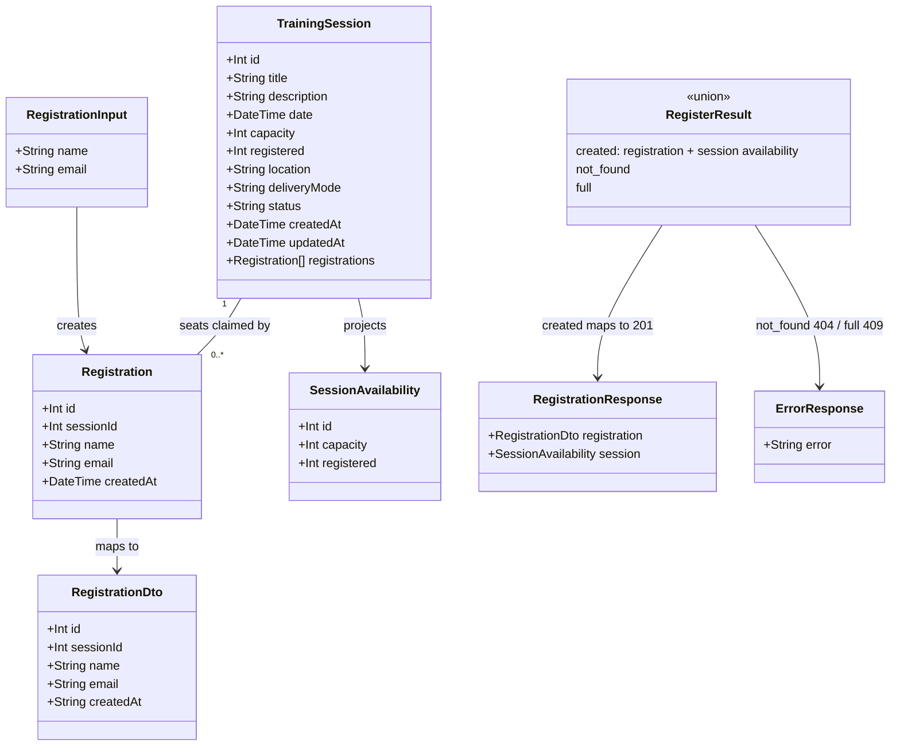

# Employee Registration for an Available Training Session (LATC-44)

## Requirements

Enable an employee to claim a seat in a training session by submitting their name and email, so they secure a place before the session fills up.

- Create a registration that consumes exactly one seat of a session's capacity, and never allow a session to be over-booked, even when employees compete for the last seat.
- Confirm a successful registration to the employee, returning a registration ID (the employee's identity for later cancel, waitlist and audit stories) and the session's updated availability.
- Reject requests clearly: 400 for missing input, 404 for an unknown session, 409 for a full session.
- Let employees register directly from the session list, and prevent the attempt in the UI when a session is full.

**Boundaries (out of scope):** duplicate-registration prevention, waitlist (LATC-3), cancellation (LATC-4), notifications (LATC-8), registration deadline (LATC-7), audit log (LATC-9), authentication, fixing the deliberate security exercises (`/search`, `routes/admin.ts`, global error handler).

**Resolved defaults for the analysis's open questions** (change via `/spdd-prompt-update` if wrong):
1. Validation is presence-only: `name` and `email` must be strings that are non-empty after trimming. There is no email-format check on the server (the browser `type="email"` gives a soft client-side hint).
2. The 201 payload contains the registration **and** the session's updated `{ id, capacity, registered }`.
3. Session `status` and `date` are not checked in this story.
4. Prisma schema change and `make reset-db` are required, and run only after explicit user approval.
5. No frontend test tooling is added. UI acceptance criteria are verified manually or in the browser.

## Entities

Notes:
- `TrainingSession` is unchanged apart from the back-relation `registrations`. The stored `registered` counter stays the source of truth for availability (conservative: no change to the list/detail contracts).
- `Registration` is new, in table `registrations`, with a foreign key to `training_sessions.id` and `onDelete: Cascade`, plus an index on `sessionId`. There is **no** unique constraint on `(sessionId, email)` (duplicates are out of scope).
- `RegistrationInput`, `RegisterResult` and `SessionAvailability` are TypeScript types in the API service module. `RegistrationDto`, `RegistrationResponse` and `ErrorResponse` are mirrored by hand in `app/src/types/index.ts` (dates are ISO strings on the wire).

## Approach

1. **API design**:
   - Nested sub-resource `POST /api/training-sessions/:id/registrations`, implemented in a **new router file** `api/src/routes/registrations.ts` (`Router({ mergeParams: true })`) mounted in `app.ts` at `/api/training-sessions/:id/registrations`. This keeps the new code out of `training-sessions.ts`, which holds the deliberate `/search` exercise.
   - Status mapping: 201 created, 400 invalid ID or input, 404 session missing, 409 session full, 500 unexpected. All errors use `{ "error": "<message>" }`.
   - 201 body: `{ registration: { id, sessionId, name, email, createdAt }, session: { id, capacity, registered } }`. This lets the UI update the card in place.

2. **Technical implementation (data and concurrency)**:
   - Prisma 5.22 + SQLite. A new `Registration` model is applied with `make reset-db` (user approval first).
   - **Atomic guarded increment, write-first** inside a single interactive `prisma.$transaction`:
     1. `updateMany` on the session with `where: { id, registered: { lt: <field ref capacity> } }` and `data: { registered: { increment: 1 } }`. The database decides who gets the last seat. Because the transaction writes first, it takes the SQLite write lock immediately, so it avoids read-then-upgrade deadlocks (`SQLITE_BUSY`).
     2. If `count === 0`, read the session inside the transaction: `null` means `not_found`, otherwise `full`. Nothing was written, so the transaction commits as a no-op.
     3. Otherwise create the `Registration` and read back the session's `id/capacity/registered`, all in the same transaction.
   - The column-to-column comparison uses Prisma field references (`prisma.trainingSession.fields.capacity`, GA in Prisma 5). No raw SQL.
   - Error handling strategy: there is **no global exception handler change** (the existing one is a deliberate stack-leak exercise). The service returns a discriminated-union result instead of throwing for business outcomes. The route maps outcomes to statuses and wraps everything in `try/catch`, returning a generic 500 `{ error: 'Failed to create registration' }`, so new code never reaches the leaking global handler.

3. **Business logic**:
   - Validation is a pure function in the service module (`validateRegistrationInput(body: unknown)`). It narrows `unknown` to `RegistrationInput`, trims both fields, and rejects missing, non-string or blank values. Because it's pure, it can be unit-tested without HTTP.
   - Session ID parsing follows the existing GET convention: `parseInt`, and `NaN` → 400 `'Invalid session ID'`.
   - Capacity rule: a session is full when `registered >= capacity` (this also covers `capacity = 0` and drifted `registered > capacity`).
   - Count–record consistency: the increment and the insert commit together, or neither does.

4. **Frontend workflow**:
   - New `RegistrationForm` component, rendered inside each `TrainingSessionCard`. It starts collapsed behind a "Register" button. When opened, it shows name and email inputs and Submit/Cancel buttons.
   - When the session is full, the card shows a **disabled** "Session full" button and no form.
   - On 201, show the confirmation message "You're registered! Your registration ID is #<id>." and push the updated availability up to the page state so the counts and "spots left" re-render.
   - On 409, show "Sorry, this session is now full." and push `registered = capacity` up, so the card flips to full.
   - On 400/404, show the server's `error` message. On a network failure, show a generic message.

5. **Risks and responses**:
   - SQLite lock contention under parallel tests: mitigated by the write-first transaction and kept short. The mandated concurrency test proves it.
   - Seed breakage from the new foreign key: `onDelete: Cascade`, and the seed also deletes registrations explicitly before sessions.
   - Shared dev database in integration tests: each test creates its own sessions and deletes them in `afterEach`/`afterAll`. Tests never rely on seed rows or test order.

## Structure

### Inheritance Relationships
1. No class hierarchies. The project uses plain functions and modules (existing convention: `trainingSessionService` exports async functions, routes export an Express `Router`).
2. `RegisterResult` is a TypeScript discriminated union (`kind: 'created' | 'not_found' | 'full'`), used instead of exception subclasses for expected business outcomes.
3. `ValidationResult` is a discriminated union (`ok: true, value` | `ok: false, error`).

### Dependencies
1. `app.ts` mounts the `registrationsRouter` at `/api/training-sessions/:id/registrations`.
2. `routes/registrations.ts` calls `validateRegistrationInput` and `registerForSession` from `services/registrationService.ts`. It does **not** import Prisma.
3. `services/registrationService.ts` depends on the shared `lib/prisma.ts` client (`$transaction`, `trainingSession.updateMany/findUnique`, `trainingSession.fields.capacity`, `registration.create`).
4. `prisma/seed.ts` calls `registration.deleteMany` before `trainingSession.deleteMany`.
5. `TrainingSessionsPage` holds the `sessions` state and passes `onAvailabilityChange` to each `TrainingSessionCard`.
6. `TrainingSessionCard` renders `RegistrationForm` directly after the meta block and forwards `onAvailabilityChange`. `RegistrationForm` owns the `session-card__actions` wrapper.
7. `RegistrationForm` calls `fetch(POST …/registrations)` and uses the `RegistrationResponse`, `ErrorResponse` and `SessionAvailability` types from `app/src/types`.

### Layered Architecture
1. **Route layer** (`api/src/routes/registrations.ts`): HTTP only. Parses `:id`, delegates body validation, calls the service, maps `RegisterResult` to a status and JSON, and catches unexpected errors into a generic 500.
2. **Service layer** (`api/src/services/registrationService.ts`): business rules (input validation, capacity invariant) and **all** Prisma access, inside one transaction.
3. **Data access layer** (`api/src/lib/prisma.ts` + `prisma/schema.prisma`): the shared client and the `Registration` model.
4. **Presentation layer** (`app/src/pages`, `app/src/components`): state ownership in the page, display in the card, interaction in the form.
5. **Contract layer** (`app/src/types/index.ts`): hand-mirrored response types, with no `any`.
6. **Exception handling**: the route-local `try/catch` returns `{ error }` with a generic message. The global handler in `app.ts` is left untouched (deliberate exercise).

## Operations

Execute in order. Tests are written before or alongside each implementation step (TDD).

### Update Prisma Schema - `api/prisma/schema.prisma`
**Requires explicit user approval (schema change + `make reset-db` deletes data).**
1. Responsibility: persist registrations and relate them to sessions.
2. Add to `model TrainingSession`:
   - `registrations Registration[]`
3. Add model `Registration`, mapped to table `registrations`, with these fields:
   - `id`: Int, primary key, auto-increment
   - `sessionId`: Int, foreign key to `TrainingSession.id`
   - `name`: String
   - `email`: String
   - `createdAt`: DateTime, defaults to now
   - `session`: relation to `TrainingSession` through `sessionId` → `id`, with `onDelete: Cascade` (deleting a session deletes its registrations)
   - An index on `sessionId`
4. Constraints: no unique constraint on email. Existing `TrainingSession` fields are unchanged.
5. Completion: `make reset-db` succeeds and the Prisma client regenerates with `prisma.registration`.

### Update Seed - `api/prisma/seed.ts`
1. Responsibility: keep `make seed` and `make reset-db` working with the new foreign key.
2. Logic: insert `await prisma.registration.deleteMany()` immediately **before** `await prisma.trainingSession.deleteMany()`. No other changes; seeded `registered` values stay 0.
3. Completion: `make seed` runs twice in a row without error.

### Create Unit Tests - `api/tests/unit/registrationService.test.ts` (RED first)
1. Mock `../../src/lib/prisma` (existing pattern) with:
   - `trainingSession: { updateMany: jest.fn(), findUnique: jest.fn(), fields: { capacity: 'capacity-field-ref' } }`
   - `registration: { create: jest.fn() }`
   - `$transaction: jest.fn((fn) => fn(<the same mock object as tx>))`
2. `validateRegistrationInput` cases:
   - Valid `{ name: ' Ada ', email: ' ada@example.com ' }` → `{ ok: true, value: { name: 'Ada', email: 'ada@example.com' } }`
   - `{}`, `null`, `undefined`, `'string'`, `[]` → `{ ok: false }`
   - Missing name, missing email → `{ ok: false }`
   - Blank `'   '` name or email → `{ ok: false }`
   - Non-string (`123`, `{}`) name or email → `{ ok: false }`
   - Extra fields are ignored (not present in `value`).
3. `registerForSession` cases:
   - **created**: `updateMany` resolves `{ count: 1 }`, `create` resolves a registration, `findUnique` resolves `{ id: 1, capacity: 20, registered: 6 }`. Expect `{ kind: 'created', registration, session: { id: 1, capacity: 20, registered: 6 } }`. Assert `updateMany` was called with `{ where: { id: 1, registered: { lt: 'capacity-field-ref' } }, data: { registered: { increment: 1 } } }`, and `create` was called with `{ data: { sessionId: 1, name, email } }`.
   - **full**: `updateMany` → `{ count: 0 }`, `findUnique` → a session. Expect `{ kind: 'full' }`; `create` not called.
   - **not_found**: `updateMany` → `{ count: 0 }`, `findUnique` → `null`. Expect `{ kind: 'not_found' }`; `create` not called.
   - Unexpected error from `create` propagates (rejects).
4. Completion: tests fail before the service exists, then pass once it's implemented.

### Implement Service - `api/src/services/registrationService.ts`
1. Exports (types):
   - `export interface RegistrationInput { name: string; email: string }`
   - `export interface SessionAvailability { id: number; capacity: number; registered: number }`
   - `export type ValidationResult = { ok: true; value: RegistrationInput } | { ok: false; error: string }`
   - `export type RegisterResult = { kind: 'created'; registration: Registration; session: SessionAvailability } | { kind: 'not_found' } | { kind: 'full' }` (`Registration` imported as a type from `@prisma/client`)
2. Module internals (not exported):
   - `const REQUIRED_FIELDS_ERROR = 'name and email are required'`
   - `nonBlankString(value: unknown): string | null` returns the trimmed string, or `null` if the value isn't a string or is blank after trimming.
3. `validateRegistrationInput(body: unknown): ValidationResult`
   - If `body` is not a non-null, non-array object → `{ ok: false, error: 'name and email are required' }`.
   - Read `name` and `email` from the body (cast to `Record<string, unknown>`) and pass each through `nonBlankString`. If either is `null`, return the same error.
   - Return `{ ok: true, value: { name, email } }` (already trimmed).
4. `registerForSession(sessionId: number, input: RegistrationInput): Promise<RegisterResult>`
   - Transaction management: the whole body runs in `prisma.$transaction(async (tx) => { ... })`.
   - Step 1, claim a seat: `const claimed = await tx.trainingSession.updateMany({ where: { id: sessionId, registered: { lt: prisma.trainingSession.fields.capacity } }, data: { registered: { increment: 1 } } })`.
   - Step 2, if `claimed.count === 0`: `const existing = await tx.trainingSession.findUnique({ where: { id: sessionId }, select: { id: true } })`. Return `existing ? { kind: 'full' } : { kind: 'not_found' }`.
   - Step 3: `const registration = await tx.registration.create({ data: { sessionId, name: input.name, email: input.email } })`.
   - Step 4: `const session = await tx.trainingSession.findUnique({ where: { id: sessionId }, select: { id: true, capacity: true, registered: true } })`. If null (impossible inside the transaction), throw `new Error('Session disappeared during registration')`, which rolls back.
   - Return `{ kind: 'created', registration, session }`.
   - Exception handling: business outcomes are returned, never thrown. Unexpected Prisma errors propagate (the transaction rolls back).
5. Dependencies: `import prisma from '../lib/prisma'` and `import type { Registration } from '@prisma/client'` only. Never `new PrismaClient()`.

### Create Integration Tests - `api/tests/integration/registrations.test.ts` (RED first)
1. Setup: import `app` and `prisma` (the test harness may use the shared client for fixtures). Helper `createSession({ capacity, registered })` creates a uniquely titled session (e.g. `LATC-44 test <Date.now()>-<random>`) and records its ID. `afterEach` deletes the recorded sessions via `prisma.trainingSession.deleteMany({ where: { id: { in: ids } } })`; registrations cascade, but also run `prisma.registration.deleteMany({ where: { sessionId: { in: ids } } })` first. `afterAll` disconnects Prisma.
2. Cases (every status code in the ACs):
   - **201**: capacity 5, registered 0, POST `{ name: 'Ada Lovelace', email: 'ada@example.com' }` → 201. The body has `registration.id` (number), `registration.sessionId === id`, trimmed `name/email`, `createdAt`, and `session` `{ id, capacity: 5, registered: 1 }`.
   - **Count increments**: after the 201, `GET /api/training-sessions/:id` shows `registered === 1`, and the DB has exactly 1 registration for the session.
   - **400 missing fields**: POST `{}` → 400, `body.error` defined. No registration created; `registered` unchanged.
   - **400 blank / wrong type**: `{ name: '  ', email: 'a@b.c' }` → 400. `{ name: 'A', email: 42 }` → 400.
   - **400 invalid ID**: POST `/api/training-sessions/abc/registrations` → 400.
   - **404**: create a session, record its ID, delete it, then POST to that ID → 404 with `body.error`. (This guarantees a non-existent ID without assuming 999 is free.)
   - **409 full**: capacity 2, registered 2 → 409 with `body.error`. No registration created; `registered` stays 2.
   - **409 capacity 0**: capacity 0, registered 0 → 409.
   - **Concurrency (last seat)**: capacity 1, registered 0. Fire 5 POSTs in parallel with `Promise.all`. Expect exactly one 201 and four 409. The final `registered === 1`, and the DB registration count for the session is 1. No 500s.
3. Completion: every case fails before the route exists, then passes once it's implemented.

### Create Route - `api/src/routes/registrations.ts`
1. Responsibility: HTTP translation only.
2. `const router: IRouter = Router({ mergeParams: true })`
3. `router.post('/', async (req: Request<{ id: string }>, res: Response) => { ... })`, with the following logic inside `try`:
   - `const sessionId = parseInt(req.params.id, 10)`. If `isNaN` → `400 { error: 'Invalid session ID' }`.
   - `const parsed = validateRegistrationInput(req.body)`. If `!parsed.ok` → `400 { error: parsed.error }`.
   - `const result = await registerForSession(sessionId, parsed.value)`.
   - `switch (result.kind)`:
     - `'not_found'` → `404 { error: 'Training session not found' }`
     - `'full'` → `409 { error: 'Training session is full' }`
     - `'created'` → `201 { registration: { id, sessionId, name, email, createdAt }, session: result.session }`
   - Exhaustiveness: a `default` branch assigns `result` to `never`.
   - `catch (error)`: `console.error('Error creating registration:', error)` → `500 { error: 'Failed to create registration' }`. Never include the stack or message.
4. Constraints: no Prisma import.

### Update App Wiring - `api/src/app.ts`
1. Add `import registrationsRouter from './routes/registrations'`.
2. Add `app.use('/api/training-sessions/:id/registrations', registrationsRouter)` next to the existing training-sessions mount (before the static/catch-all block).
3. Do not modify the global error handler or the other routers.

### Update Frontend Types - `app/src/types/index.ts`
1. Add these exported interfaces after `TrainingSession`, with no `any`:
   - `Registration`: `id` (number), `sessionId` (number), `name` (string), `email` (string), `createdAt` (string, ISO date on the wire)
   - `SessionAvailability`: `id` (number), `capacity` (number), `registered` (number)
   - `RegistrationResponse`: `registration` (`Registration`) and `session` (`SessionAvailability`), the shape of the 201 body
   - `ErrorResponse`: `error` (string), the shape of every error body

### Create Component - `app/src/components/RegistrationForm.tsx`
1. Responsibility: collect name/email, submit, and report the outcome.
2. Props: `{ session: TrainingSession; onAvailabilityChange: (update: SessionAvailability) => void }`
3. State: `open: boolean`, `name: string`, `email: string`, `submitting: boolean`, `message: { kind: 'success' | 'error'; text: string } | null`.
4. Type guards (module-local): `isRecord(value: unknown): value is Record<string, unknown>`; `isRegistrationResponse` (checks `registration.id`, `session.id/capacity/registered` are numbers); `isErrorResponse` (checks `error` is a string).
5. Rendering (every state is wrapped in `
`):
   - `isFull = session.registered >= session.capacity`.
   - If `isFull`: render `<button type="button" className="register-button" disabled>Session full</button>`, plus the message element.
   - Else if `!open`: render a "Register" button that sets `open = true` and clears `message`, plus the message element.
   - Else: render a `<form className="registration-form">` with labelled inputs `name` (text, required, autoComplete="name") and `email` (type="email", required, autoComplete="email"), and a `registration-form__actions` row with a Submit button (disabled while `submitting`, label "Registering…"/"Confirm registration") and a Cancel button (`register-button register-button--secondary`, disabled while `submitting`) that closes the form. Then the message element.
   - Message element: a `
` that is always rendered, so screen readers announce changes. Its class is `registration-message registration-message--<kind>` when a message exists, and it is empty otherwise.
6. `handleSubmit(e: FormEvent<HTMLFormElement>)`:
   - `preventDefault`, set `submitting`, then `fetch(`${API_BASE}/api/training-sessions/${session.id}/registrations`, { method: 'POST', headers: { 'Content-Type': 'application/json' }, body: JSON.stringify({ name, email }) })`, where `API_BASE = import.meta.env.VITE_API_URL || ''`.
   - Parse the JSON as `unknown`, then narrow with small type guards `isRegistrationResponse(x): x is RegistrationResponse` and `isErrorResponse(x): x is ErrorResponse`.
   - 201 + valid response: `onAvailabilityChange(data.session)`. Set the success message `You're registered! Your registration ID is #${data.registration.id}.`, reset the fields and close the form.
   - 409: `onAvailabilityChange({ id: session.id, capacity: session.capacity, registered: session.capacity })` and set the error message `Sorry, this session is now full.`
   - Other non-OK: error message = server `error` if it narrows, else `Registration failed (status <n>).`
   - Network or parse failure: `Could not reach the server. Please try again.`
   - `finally`: clear `submitting`.

### Update Component - `app/src/components/TrainingSessionCard.tsx`
1. Props become `{ session: TrainingSession; onAvailabilityChange: (update: SessionAvailability) => void }`.
2. Render `<RegistrationForm session={session} onAvailabilityChange={onAvailabilityChange} />` directly after the meta block (no wrapper in the card; the form supplies `session-card__actions`).
3. The existing display logic (Full badge, spots left) is unchanged. It re-renders from the updated props.

### Update Page - `app/src/pages/TrainingSessionsPage.tsx`
1. Add `handleAvailabilityChange(update: SessionAvailability)`, which calls `setSessions(prev => prev.map(s => s.id === update.id ? { ...s, capacity: update.capacity, registered: update.registered } : s))`.
2. Pass `onAvailabilityChange={handleAvailabilityChange}` to each card. The fetch logic is unchanged.

### Update Styles - `app/src/components/TrainingSessionCard.css`
1. Append `.session-card__actions`, `.register-button` (plus `:disabled`), `.register-button--secondary` (outline style for Cancel), `.registration-form`, `.registration-form__field`, `.registration-form__field input`, `.registration-form__actions`, `.registration-message--success` and `.registration-message--error`. Use the existing CSS variables (`--color-primary`, `--color-border`, `--color-text-muted`, `--color-error`) and the card's green `#16a34a` for success. Prettier-formatted.

### Update Docs - `README.md`
1. Add the row `| POST | /api/training-sessions/:id/registrations | Register for a session |` to the API Endpoints table.

### Verify
1. `make test`, `make lint`, `make format-check` and `make build` all pass.
2. `make dev`, then in the browser: the Register button is visible on each card; register succeeds, shows the confirmation and the count increments; registering a capacity-limited session to full flips it to a disabled "Session full"; a stale 409 shows the full message.
3. `make smoke-test` still passes. It assumes the seeded session IDs start at 1, and IDs use AUTOINCREMENT, so a standalone `make seed` shifts them. Run `make reset-db` first (not just `make seed`) before smoke-testing.

## Norms

1. **Module conventions**: routes are kebab-case files exporting a default `Router` typed `IRouter`. Services are camelCase files exporting named async functions. Components are PascalCase `.tsx` with a default export and a co-located CSS file.
2. **Dependency access**: import the shared client from `lib/prisma` in services only. No Prisma in routes and no `new PrismaClient()` outside `lib/prisma.ts` (test files use the shared client for fixtures).
3. **Exception handling**:
   - Expected business outcomes (`not_found`, `full`, invalid input) are typed return values (discriminated unions), not exceptions.
   - Unexpected errors propagate from the service, and are caught and logged in the route with a generic 500 `{ error }`.
   - Error response format is always exactly `{ "error": "<message>" }`. There is no `stack`, Prisma message or timestamp in new code.
   - Log with `console.error('<context>:', error)` (existing pattern). Never log request bodies (they contain the email).
4. **Data validation**: accept `unknown`, narrow with `typeof` checks and type guards, and trim strings before use and persistence. Validation lives in the service module as a pure function so it can be unit-tested.
5. **Typing**: no `any`, including in tests (use `jest.Mock` casts as the existing tests do). Types shared over HTTP are mirrored explicitly in `app/src/types`. Use exhaustive `switch` with `never` on discriminated unions.
6. **Formatting**: Prettier from `.prettierrc` (no semicolons, single quotes, trailing commas es5, width 100). Run through `make format-check`, never hand-formatted against it.
7. **Testing**: unit tests mock `lib/prisma` (no DB). Integration tests use Supertest against `app` with self-created fixtures, clean up after themselves, and have no dependence on seed data or order. Every AC status code has a test, plus the concurrency test.
8. **Documentation**: comments only where intent isn't obvious (e.g. why the increment comes first in the transaction). Keep the README endpoint table current.
9. **Commits**: via `/workshophub-commit` with the `LATC-44 feat(scope): summary` format, on a feature branch (not `main`).

## Safeguards

1. **Functional constraints**:
   - `POST /api/training-sessions/:id/registrations` returns exactly: 201 on success, 400 for a non-numeric ID or missing/blank/non-string `name` or `email`, 404 for an unknown session, 409 when `registered >= capacity`.
   - Every 201 increases `registered` by exactly 1 and creates exactly 1 registration row. Every non-201 changes neither.
   - The UI shows a register control on every card. It is disabled ("Session full") when `registered >= capacity`, and shows a confirmation with the registration ID on success.
2. **Performance constraints**: the registration transaction performs at most 4 statements (update, read or create, read). No N+1 queries and no full-table reads. Five parallel requests against one seat complete without any 500 or timeout under the default Prisma transaction settings.
3. **Security constraints**: no `$queryRawUnsafe` and no string-built SQL (field references only). No stack traces or internal error text in responses. Do not modify or copy the deliberate exercises (`/search`, `routes/admin.ts`, the global error handler). Do not log personal data (name/email). Do not read or write `.env`.
4. **Integration constraints**: the existing `GET /api/training-sessions` and `GET /:id` responses are unchanged (no new fields are required by the app). `make smoke-test` still passes. `app` and `api` types stay in sync manually.
5. **Business rule constraints**:
   - Capacity invariant: `registered <= capacity` always holds after any registration attempt, enforced in the database by the conditional update, never by an application-side read-then-check.
   - Duplicate registrations by the same email are **allowed** (no unique index, no check).
   - Session `status` and `date` are not checked (deadline is LATC-7).
6. **Exception handling constraints**:
   - Business outcomes are typed results with fixed messages: `'Invalid session ID'`, `'name and email are required'`, `'Training session not found'`, `'Training session is full'`.
   - Unexpected failures return 500 `{ error: 'Failed to create registration' }` and are logged server-side only.
   - New code must handle its own errors and never rely on the global error handler.
7. **Technical constraints**: no new dependencies (API or app). Node 24, TypeScript 5.9, Express 4, Prisma 5.22, React 18. Seat claim and registration insert happen in **one** `prisma.$transaction`. The schema change is applied only via `make reset-db` after user approval.
8. **Data constraints**: `name` and `email` are stored trimmed and non-empty. `sessionId` must reference an existing session (foreign key, `onDelete: Cascade`). `createdAt` is set by the database.
9. **API constraints**: request `Content-Type: application/json` with body `{ name: string, email: string }` (extra fields ignored). The 201 body is `{ registration: { id, sessionId, name, email, createdAt }, session: { id, capacity, registered } }`. Error bodies are `{ error: string }`.
10. **Process constraints (Definition of Done)**: tests are written first or alongside. `make test`, `make lint`, `make format-check` and `make build` all pass. Never use `--no-verify`. The seed runs after `make reset-db`. Work happens on a feature branch, never committing to `main`.
