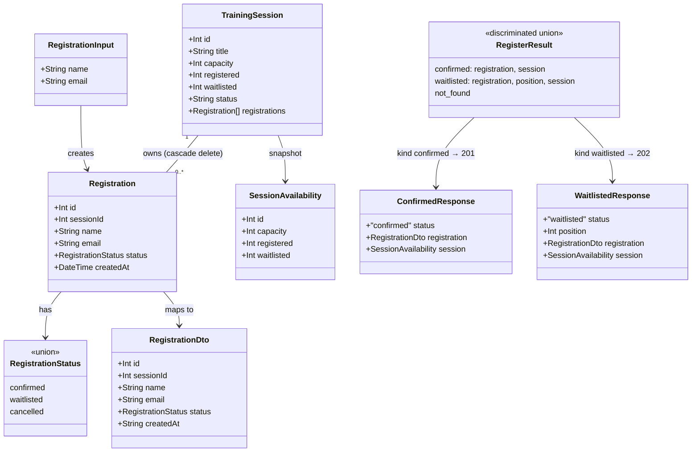

# Waitlist When a Training Session Is Full

## Requirements

1. Capture demand for full training sessions: when no seat is left, put the employee on an ordered waitlist instead of turning them away, so a place can later be offered (WH-4 cancellation → WH-5 promotion).
2. Give every registration an explicit lifecycle status (`confirmed` or `waitlisted`; `cancelled` is reserved for WH-4), and keep the confirmed-seat count and the waitlisted count separate.
3. Tell the employee clearly which outcome they got: a confirmed seat (HTTP 201) or a waitlist place with their 1-based position (HTTP 202), never confusing the two.
4. Keep the LATC-44 capacity guarantee intact under concurrency: confirmed registrations never exceed `capacity`, and concurrent waitlist joins get unique, gap-free positions.
5. Boundaries: the waitlist is unbounded. Waitlist promotion, cancellation, notifications and duplicate prevention are out of scope. `POST /api/training-sessions/:id/registrations` stays the only write endpoint, and a full session no longer returns 409.

## Entities

Notes:
- `waitlisted` on `TrainingSession` is new: a denormalised counter of `waitlisted` registrations, next to `registered` (the counter of `confirmed` ones).
- `status` on `Registration` is new: a SQLite string column defaulting to `"confirmed"`, typed in TypeScript as `RegistrationStatus = 'confirmed' | 'waitlisted' | 'cancelled'`.
- Waitlist position is **not** stored. It is computed from the rows: the number of the session's `waitlisted` registrations with `id <=` this registration's id.
- `RegisterResult` replaces the LATC-44 variants `created | not_found | full` with `confirmed | waitlisted | not_found`. The `full` outcome no longer exists.

## Approach

1. **Data model (extend, don't restructure)**:
   - Add `status String @default("confirmed")` to `Registration` and `waitlisted Int @default(0)` to `TrainingSession`. Defaults keep existing rows and the seed valid. Index `[sessionId, status]` to support the position count.
   - Plain string plus a TypeScript union, because SQLite under Prisma 5 has no native enums and the codebase already uses strings for `status` and `deliveryMode`.
   - The waitlist is the set of `waitlisted` registrations for a session, not a separate table, so a registration keeps its id (the employee's identity) through a future promotion (WH-5).

2. **Registration flow (one transaction, existing serial queue)**:
   - `registerForSession` still runs through the in-process `serialize` queue and one `prisma.$transaction`.
   - Step 1 is unchanged: conditional increment of `registered` where `registered < capacity`. If it claims a seat, create the registration with `status: 'confirmed'` explicitly and return `confirmed`.
   - If no seat is claimed, check the session exists (`not_found` otherwise, with no writes). If it exists, increment `waitlisted`, create the registration with `status: 'waitlisted'`, compute its position by counting the session's waitlisted rows with `id <=` the new id, and return `waitlisted`.
   - Position is derived rather than taken from the counter so it stays correct once WH-4/WH-5 remove entries. Ordering by autoincrement `id` (not `createdAt`) avoids timestamp ties.
   - The serial queue plus the transaction make the counter increment and the count race-free on SQLite with no new locking.

3. **HTTP contract**:
   - 201 when confirmed, 202 when waitlisted. Both bodies share one shape with a top-level `status` discriminator: `{ status, registration, session }`, plus `position` on 202. The existing `registration` and `session` keys stay, so the LATC-44 UI contract is extended, not broken.
   - The registration id is returned on 202 too, because it identifies the employee for a later cancellation.
   - 400 and 404 behaviour is unchanged. 409 is removed from this endpoint.
   - The route keeps its exhaustive `switch` with a `never` check, and its local `try/catch` returning a generic 500 `{ error }`. The global error handler stays untouched (deliberate exercise).

4. **Frontend**:
   - A full card shows a "Join Waitlist" button that opens the same name/email form. Submit reads "Join waitlist" for a full session and "Confirm registration" otherwise.
   - The form branches on the response status (201 or 202), not on what the card assumed, so a stale card that hits a newly full session still shows the waitlist message.
   - On 202 it shows "You're on the waitlist at position N. Your place is not confirmed yet. Your registration ID is #id." and updates the card's availability (which now includes `waitlisted`).
   - The card shows "N on waitlist" in the capacity line when `waitlisted > 0`. This field comes for free on `GET /api/training-sessions` because the service returns whole rows.

5. **Testing strategy (TDD, slice by slice)**:
   - Unit (mocked Prisma): confirmed path writes `status: 'confirmed'`. The full path increments `waitlisted`, creates `status: 'waitlisted'`, counts the position and returns it. `not_found` does no writes. Serialisation still holds.
   - Integration (real SQLite, self-created fixtures): 201 with `status: "confirmed"` and DB status `confirmed`; 202 with `status: "waitlisted"` and positions 1 then 2; capacity 0 gives 202; 404 creates no row; counters stay separate; and two concurrency tests, one for the last seat and one for parallel waitlist joins.
   - LATC-44's 409 tests are **rewritten** to the new behaviour, not deleted.

## Structure

### Inheritance Relationships
1. There are no classes or inheritance. The codebase uses modules with exported functions, plus TypeScript discriminated unions.
2. `RegisterResult` is a discriminated union on `kind` (`'confirmed' | 'waitlisted' | 'not_found'`). The route narrows it exhaustively.
3. On the frontend, `RegistrationResponse` is a discriminated union on `status` (`ConfirmedRegistrationResponse | WaitlistedRegistrationResponse`), narrowed by runtime type guards.

### Dependencies
1. `routes/registrations.ts` calls `validateRegistrationInput` and `registerForSession` from `services/registrationService.ts`.
2. `services/registrationService.ts` depends on `lib/prisma.ts` (the shared client) and its `$transaction`, `trainingSession.updateMany/update/findUnique`, and `registration.create/count`.
3. `app.ts` mounts the registrations router at `/api/training-sessions/:id/registrations` (unchanged).
4. `RegistrationForm.tsx` depends on `types/index.ts` and calls the POST endpoint. `TrainingSessionCard.tsx` renders `RegistrationForm`. `TrainingSessionsPage.tsx` owns the session list state and merges `SessionAvailability` updates.

### Layered Architecture
1. **Route layer** (`api/src/routes/registrations.ts`): parse the id, validate the body, call the service, map the result to 201/202/404 bodies. No Prisma.
2. **Service layer** (`api/src/services/registrationService.ts`): input validation, the seat-claim or waitlist decision, the transaction and serial queue, position calculation. All Prisma access lives here.
3. **Data layer** (`api/prisma/schema.prisma`, `lib/prisma.ts`): `TrainingSession` (with `registered` and `waitlisted` counters) and `Registration` (with `status`).
4. **UI layer** (`app/src/components`, `app/src/pages`): card, form and page state.
5. **Contract layer** (`app/src/types/index.ts`): hand-mirrored response types with the status unions. No `any`.
6. **Exception handling**: expected outcomes are typed results. Unexpected errors are caught in the route's local `try/catch` → 500 `{ error: 'Failed to create registration' }`, and logged without personal data.

## Operations

Execute in order. Write the tests in each slice first (RED), then implement (GREEN).

### Update Prisma Schema - `api/prisma/schema.prisma`
**Requires explicit user approval (schema change, plus `make reset-db`, which deletes data).**
1. Responsibility: persist registration status and a separate waitlisted counter.
2. In `model TrainingSession`, add `waitlisted Int @default(0)` directly after `registered`.
3. In `model Registration`, add `status String @default("confirmed")` after `email`. Add `@@index([sessionId, status])`, keeping the existing `@@index([sessionId])`.
4. Constraints: no other field changes, no unique constraint on email, table names unchanged.
5. Apply with `make reset-db` (after approval). Confirm the seed still runs. The seed needs no change because both new fields have defaults.

### Update Unit Tests - `api/tests/unit/registrationService.test.ts` (RED first)
1. Extend the Prisma mock: add `trainingSession.update: jest.fn()` and `registration.count: jest.fn()`, with matching `mockUpdate` and `mockCount` handles reset in `afterEach`. Add `status: 'confirmed'` to the `createdRegistration` fixture and define a `waitlistedRegistration` fixture (`id: 43`, `status: 'waitlisted'`).
2. Rewrite "claims a seat…": expect `kind: 'confirmed'`, `registration.create` called with `data: { sessionId: 1, name, email, status: 'confirmed' }`, and the availability select now including `waitlisted`. `mockFindUnique` resolves `{ id: 1, capacity: 20, registered: 6, waitlisted: 0 }`.
3. Replace "returns full…" with "adds the registration to the waitlist when no seat could be claimed":
   - `updateMany → { count: 0 }`, first `findUnique → { id: 1 }`, `update → { id: 1, capacity: 2, registered: 2, waitlisted: 3 }`, `create → waitlistedRegistration`, `count → 3`.
   - Expect the result `{ kind: 'waitlisted', registration: waitlistedRegistration, position: 3, session: { id: 1, capacity: 2, registered: 2, waitlisted: 3 } }`.
   - Expect `update` called with `{ where: { id: 1 }, data: { waitlisted: { increment: 1 } }, select: { id: true, capacity: true, registered: true, waitlisted: true } }`.
   - Expect `create` called with `data: { …input, sessionId: 1, status: 'waitlisted' }`.
   - Expect `count` called with `{ where: { sessionId: 1, status: 'waitlisted', id: { lte: 43 } } }`.
4. "returns not_found…": additionally assert that `update` and `create` were not called.
5. Keep the serialisation and failure-recovery tests, updating their expected `kind` to `'confirmed'`.

### Implement Service - `api/src/services/registrationService.ts`
1. Exports:
   - `type RegistrationStatus = 'confirmed' | 'waitlisted' | 'cancelled'`
   - `SessionAvailability { id; capacity; registered; waitlisted }`
   - `RegisterResult = { kind: 'confirmed'; registration: Registration; session: SessionAvailability } | { kind: 'waitlisted'; registration: Registration; position: number; session: SessionAvailability } | { kind: 'not_found' }`
2. A module constant `AVAILABILITY_SELECT = { id: true, capacity: true, registered: true, waitlisted: true } as const`, used for every availability read.
3. `registerForSession(sessionId, input): Promise<RegisterResult>`: unchanged wrapper, `serialize(() => claimSeatOrWaitlist(sessionId, input))`.
4. `claimSeatOrWaitlist(sessionId, input)` (renamed from `claimSeatAndRegister`), inside `prisma.$transaction(async (tx) => …)`:
   - The conditional `updateMany` claim is identical to LATC-44.
   - **Claimed:** `tx.registration.create({ data: { sessionId, name, email, status: 'confirmed' } })`, then `tx.trainingSession.findUnique({ where: { id: sessionId }, select: AVAILABILITY_SELECT })`. A null result throws `Error('Session disappeared during registration')`. Return `{ kind: 'confirmed', registration, session }`.
   - **Not claimed:** `tx.trainingSession.findUnique({ where: { id: sessionId }, select: { id: true } })`. If null, return `{ kind: 'not_found' }` with no writes.
   - **Waitlist:** `session = tx.trainingSession.update({ where: { id: sessionId }, data: { waitlisted: { increment: 1 } }, select: AVAILABILITY_SELECT })`; then `registration = tx.registration.create({ data: { sessionId, name, email, status: 'waitlisted' } })`; then `position = tx.registration.count({ where: { sessionId, status: 'waitlisted', id: { lte: registration.id } } })`. Return `{ kind: 'waitlisted', registration, position, session }`.
5. Update the comment above the transaction: claiming a seat first is still the capacity guarantee, and the waitlist path runs inside the same serialised transaction, which keeps positions unique.
6. Constraints: status values come only from these literals, never from client input. `validateRegistrationInput` is unchanged and ignores any `status` in the body.

### Update Integration Tests - `api/tests/integration/registrations.test.ts` (RED first)
1. Helpers: add `waitlistedCount(sessionId)` (reads `trainingSession.waitlisted`) and `statusesFor(sessionId)` (registrations ordered by `id`, mapped to `status`). All fixture titles in the file use the `LATC-64 test` prefix.
2. Update the 201 test: expect `body.status === 'confirmed'`, `body.registration.status === 'confirmed'`, `body.session.waitlisted === 0`, and DB statuses `['confirmed']`.
3. Replace "returns 409 when the session is full" with "returns 202 and adds the employee to the waitlist when full": `createSession(2, 2)` → 202, `body.status === 'waitlisted'`, `body.position === 1`, a numeric `body.registration.id`, `body.registration.status === 'waitlisted'`, `registered` still 2, `waitlisted` 1, DB statuses `['waitlisted']`.
4. New "assigns waitlist positions in arrival order": two sequential POSTs to a full session → positions 1 then 2, and `waitlisted === 2`.
5. Replace the zero-capacity 409 test: `createSession(0, 0)` → 202 with position 1 and `registered` still 0.
6. Update the 404 test: also assert that no registration row exists for that id.
7. Rewrite the last-seat concurrency test: `createSession(1, 0)` with 5 parallel POSTs → sorted statuses `[201, 202, 202, 202, 202]`, the 202 positions sorted are `[1, 2, 3, 4]`, `registered === 1`, `waitlisted === 4`, and the DB has 1 `confirmed` and 4 `waitlisted` rows.
8. New "gives unique positions to concurrent waitlist joins": `createSession(1, 1)` with 5 parallel POSTs → all 202, positions sorted `[1..5]`, `waitlisted === 5`, `registered === 1`.
9. New "tracks waitlisted separately from registered": `createSession(1, 0)` with 3 sequential POSTs → 1 confirmed, 2 waitlisted, `registered === 1`, `waitlisted === 2`, matching the row counts per status.
10. `afterEach` cleanup is unchanged (registrations by sessionId, then sessions).

### Update Route - `api/src/routes/registrations.ts`
1. Add a local `toRegistrationDto(registration: StoredRegistration, status: RegistrationStatus)` returning `{ id, sessionId, name, email, status, createdAt }`. `StoredRegistration` is derived from the service's `RegisterResult` type (`Extract<…>['registration']`), so the route imports nothing from `@prisma/client`. Pass the literal status from the result kind rather than casting the DB string.
2. `switch (result.kind)`:
   - `'not_found'` → 404 `{ error: 'Training session not found' }` (unchanged).
   - `'confirmed'` → 201 `{ status: 'confirmed', registration: toRegistrationDto(result.registration, 'confirmed'), session: result.session }`.
   - `'waitlisted'` → 202 `{ status: 'waitlisted', position: result.position, registration: toRegistrationDto(result.registration, 'waitlisted'), session: result.session }`.
   - Keep the `default` branch with the `never` check.
3. Remove the `'full'` case and the `'Training session is full'` message. 400 handling and the 500 catch are unchanged.

### Update Frontend Types - `app/src/types/index.ts`
1. Add `export type RegistrationStatus = 'confirmed' | 'waitlisted' | 'cancelled'`.
2. Add `waitlisted: number` to `TrainingSession` and to `SessionAvailability`.
3. Add `status: RegistrationStatus` to `Registration`.
4. Replace `RegistrationResponse` with:
   - `ConfirmedRegistrationResponse { status: 'confirmed'; registration: Registration; session: SessionAvailability }`
   - `WaitlistedRegistrationResponse { status: 'waitlisted'; position: number; registration: Registration; session: SessionAvailability }`
   - `type RegistrationResponse = ConfirmedRegistrationResponse | WaitlistedRegistrationResponse`

### Update Component - `app/src/components/RegistrationForm.tsx`
1. Type guards:
   - Extend `isSessionAvailability` checks to include a numeric `waitlisted`.
   - `isConfirmedResponse(value)` checks `status === 'confirmed'` plus the registration and session.
   - `isWaitlistedResponse(value)` checks `status === 'waitlisted'`, a numeric `position`, plus the registration and session.
2. `handleSubmit`:
   - `201 && isConfirmedResponse` → `onAvailabilityChange(data.session)`, success message "You're registered! Your registration ID is #id.", reset fields, close the form.
   - `202 && isWaitlistedResponse` → `onAvailabilityChange(data.session)`, message kind `'waitlisted'`: "You're on the waitlist at position N. Your place is not confirmed yet. Your registration ID is #id.", reset fields, close the form.
   - Anything else → error message from `{ error }`, or `Registration failed (status X).`
   - Remove the 409 branch.
3. `Message.kind` becomes `'success' | 'waitlisted' | 'error'`.
4. Rendering:
   - When the form is closed, the button reads "Join Waitlist" if `isFull`, otherwise "Register". It is enabled in both cases. Remove the disabled "Session full" button.
   - When the form is open, the submit label is "Join waitlist" / "Joining…" if full, otherwise "Confirm registration" / "Registering…".

### Update Component - `app/src/components/TrainingSessionCard.tsx`
1. In the Capacity meta value, after the registered and spots-left text, render ` · {n} on waitlist` when `session.waitlisted > 0`.
2. Keep the "Full" badge and `session-card--full` class logic unchanged.

### Update Styles - `app/src/components/TrainingSessionCard.css`
1. Add `.registration-message--waitlisted` (amber, distinct from success green and error red) and `.waitlist-count` (muted text).
2. Move the full-card fade from the whole `.session-card--full` to its description and meta only, so the "Join Waitlist" button stays fully visible.

### Update Page - `app/src/pages/TrainingSessionsPage.tsx`
1. `handleAvailabilityChange` also merges `waitlisted: update.waitlisted`.

### Update Docs - `README.md`
1. Change the POST row description to "Register for a session (joins the waitlist when full)".

### Verify
1. `make test`, `make lint`, `make format-check` and `make build` all pass.
2. `make reset-db`, then `make dev`. In the browser:
   - Fill a small session (for example via repeated registrations).
   - The card flips to "Full" with a "Join Waitlist" button.
   - Joining shows the waitlist message with position 1, then 2.
   - The card shows "N on waitlist" while `registered` doesn't change.
3. `make smoke-test` still passes (run after `make reset-db`).

## Norms

1. **Module conventions**: routes are kebab-case files exporting a default `Router` typed `IRouter`. Services are camelCase files exporting named async functions and types. Components are PascalCase `.tsx` with a default export and a co-located CSS file.
2. **Dependency access**: the shared client from `lib/prisma` is used in services only. No Prisma in routes, and no `new PrismaClient()` outside `lib/prisma.ts` (tests use the shared client for fixtures).
3. **Exception handling**:
   - Expected outcomes (`confirmed`, `waitlisted`, `not_found`, invalid input) are typed return values, not exceptions.
   - Unexpected errors propagate from the service, and are caught and logged in the route as a generic 500 `{ error }`.
   - The error body is exactly `{ "error": "<message>" }`, with no stack or Prisma text.
   - Log with `console.error('<context>:', error)`. Never log request bodies or emails.
4. **Data validation**: accept `unknown` and narrow with type guards on both sides of HTTP. Never accept `status` or `position` from the client.
5. **Typing**: no `any` (tests use `jest.Mock` casts). Status values are string-literal unions. Use exhaustive `switch` with `never` on `RegisterResult`. Map DB rows to DTOs explicitly in the route.
6. **Formatting**: Prettier from `.prettierrc` (no semicolons, single quotes, width 100), checked by `make format-check`.
7. **Testing**: unit tests mock `lib/prisma`. Integration tests use Supertest with self-created fixtures and their own cleanup, with no dependence on seed data or order. Every AC status code (201, 202, 400, 404) has a test, plus both concurrency tests. Superseded LATC-44 assertions are rewritten to the new contract, never deleted silently or weakened.
8. **Documentation**: comments only where intent isn't obvious (why position is counted rather than stored, and why the waitlist path stays in the serialised transaction). Keep the README endpoint table current.
9. **Commits**: via `/workshophub-commit` with the `LATC-64 feat(scope): summary` format, on `latc-64-waitlist-full-training-session` (never `main`).

## Safeguards

1. **Functional constraints**:
   - `POST /api/training-sessions/:id/registrations` returns exactly: 201 when a seat was claimed, 202 when the session is full (including capacity 0), 400 for a non-numeric id or missing/blank/non-string `name`/`email`, and 404 for an unknown session. It never returns 409.
   - Every 201 increases `registered` by 1, leaves `waitlisted` unchanged, and creates 1 `confirmed` row.
   - Every 202 increases `waitlisted` by 1, leaves `registered` unchanged, and creates 1 `waitlisted` row.
   - 400 and 404 change nothing.
   - A full card shows "Join Waitlist" (enabled). A 202 shows a message that states the position and that the place is not confirmed.
2. **Performance constraints**: the waitlist transaction runs at most 5 statements (claim, existence check, increment, insert, count). The position count uses the `[sessionId, status]` index. Five parallel requests against a full or one-seat session complete without a 500 or timeout, even with `TOKIO_WORKER_THREADS=1`. Don't raise Prisma timeouts to hide contention.
3. **Security constraints**: no `$queryRawUnsafe` and no string-built SQL. No internal error detail in responses. Don't touch or copy the deliberate exercises (`/search`, `routes/admin.ts`, the global error handler). Don't log names or emails. Don't read or write `.env`.
4. **Integration constraints**: `GET /api/training-sessions` and `GET /:id` gain only the additive `waitlisted` field. The 201 body keeps its `registration` and `session` keys (additive `status` fields only). `make smoke-test` still passes. `api` and `app` types are updated together.
5. **Business rule constraints**:
   - Capacity invariant: `registered <= capacity` and `registered ==` the count of `confirmed` rows, after any attempt.
   - `waitlisted ==` the count of `waitlisted` rows for the session.
   - Positions for a session are 1-based, unique and contiguous in arrival (`id`) order.
   - The waitlist is unbounded. Duplicate emails are allowed. Nothing in this story sets `cancelled`.
6. **Exception handling constraints**:
   - Fixed messages: `'Invalid session ID'`, `'name and email are required'`, `'Training session not found'`.
   - Unexpected failures → 500 `{ error: 'Failed to create registration' }`, logged server-side only.
   - New code never relies on the global error handler.
7. **Technical constraints**:
   - No new dependencies. Node 24, TypeScript 5.9, Express 4, Prisma 5.22, React 18.
   - The claim, existence check, counter update, insert and position count all happen in **one** `prisma.$transaction`, executed through the existing serial queue.
   - The schema change is applied only via `make reset-db` after user approval.
8. **Data constraints**:
   - `status` is one of `confirmed | waitlisted | cancelled`, defaults to `confirmed`, and is set only by the service.
   - `waitlisted` is a non-negative integer defaulting to 0.
   - `name` and `email` are stored trimmed and non-empty.
9. **API constraints**:
   - 201 body: `{ status: 'confirmed', registration: { id, sessionId, name, email, status: 'confirmed', createdAt }, session: { id, capacity, registered, waitlisted } }`.
   - 202 body: `{ status: 'waitlisted', position, registration: { id, sessionId, name, email, status: 'waitlisted', createdAt }, session: { id, capacity, registered, waitlisted } }`.
   - Error body: `{ error: string }`.
10. **Process constraints (Definition of Done)**:
    - Tests are written first or alongside.
    - `make test`, `make lint`, `make format-check` and `make build` all pass. Never use `--no-verify`.
    - The seed runs after `make reset-db`.
    - Work happens on a feature branch.
